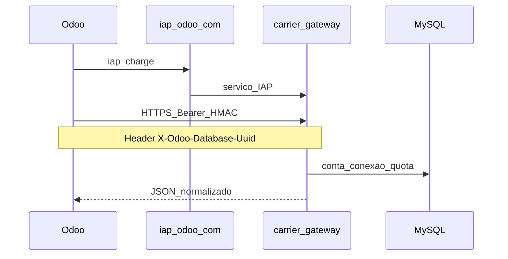

# Arquitetura OdooCarriers

Documento derivado de [PROPOSTA_FUNCIONAL.md](./PROPOSTA_FUNCIONAL.md) (secção 2).

## Camadas

| Camada | Responsabilidade |
|--------|------------------|
| **Odoo (`addons/`)** | UI, `delivery.carrier`, onboarding, IAP, excepções, e-commerce |
| **Carrier gateway** | Auth IAP, domínio normalizado, serviços (idempotência, filas), adaptadores DPD |
| **MySQL** | Conexões, credenciais cifradas, remessas, consumo IAP (sem PII de destinatário) |

## Runtime actual vs alvo

| Alvo (PROPOSTA) | Interim no repo | Notas |
|-----------------|-----------------|-------|
| `carrier_gateway/` | [`hub-gateway/`](../hub-gateway/) | FastAPI; renomeação física adiada |
| `addons/odoocarriers_base` | [`shipping_hub_connector/`](../shipping_hub_connector/) | Multi-carrier legado; evoluir para DPD-first |
| `addons/delivery_dpd_*` | — | A criar |

## Autenticação (meta PROPOSTA §2)

**Transição:** Bearer API token (ponte) + header `X-Odoo-Database-Uuid`; meta = só IAP sem token manual.

## Referências

- [ESTRUTURA.md](./ESTRUTURA.md) — pastas
- [STACK_TECNICA.md](./STACK_TECNICA.md) — stack Python/MySQL
- [FUNCIONALIDADES_PLANEJADAS.md](./FUNCIONALIDADES_PLANEJADAS.md) — backlog
