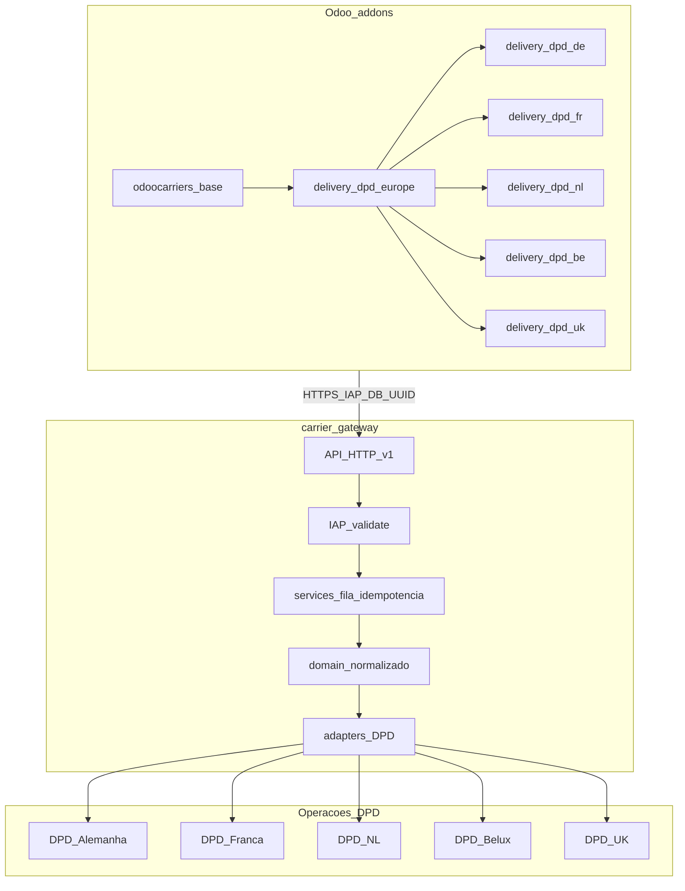
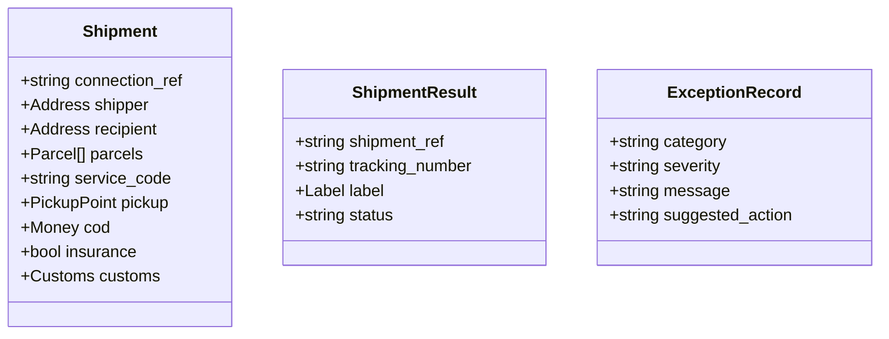
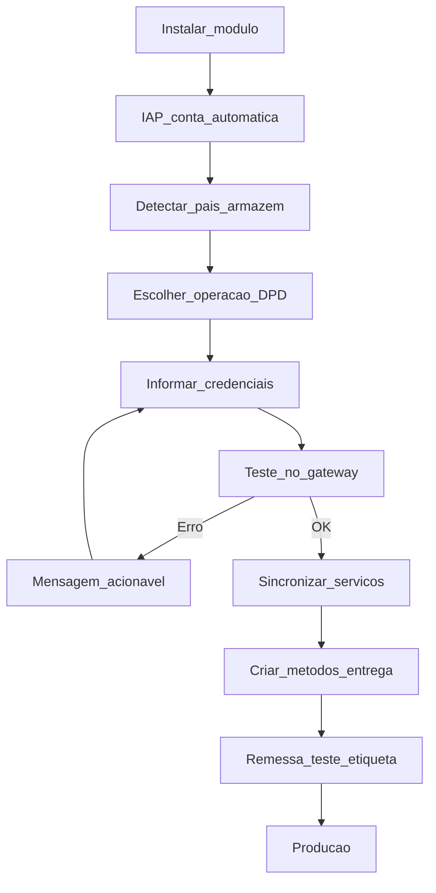
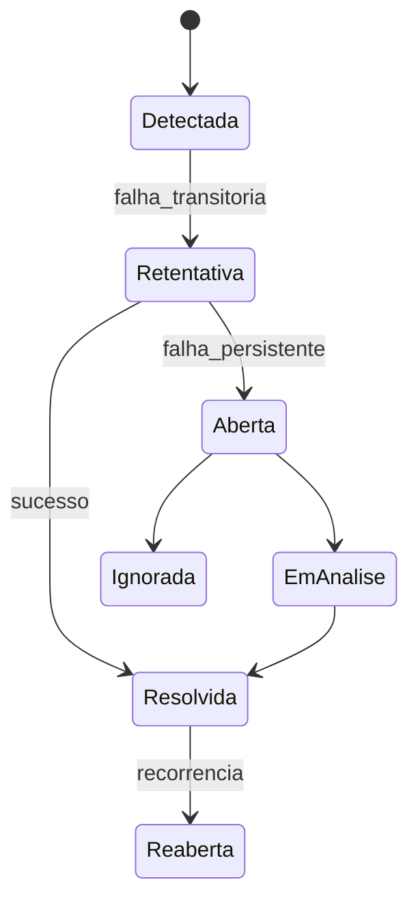
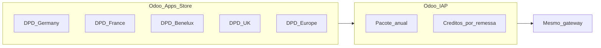
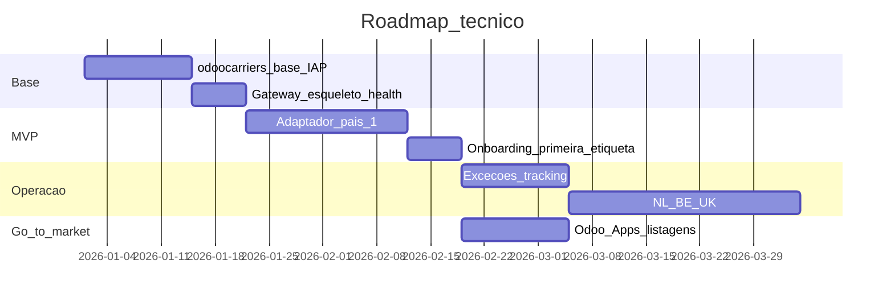

# Proposta funcional — OdooCarriers

Documento **mestre** de diretrizes do projeto. Qualquer implementação deve estar alinhada a este ficheiro.

Versão: 1.0 · 2026-10-11

---

## 1. Visão

Integração **DPD/Geopost multipaís** para Odoo (Community e Enterprise, Odoo.sh e on-premise), **sem** portal SaaS externo, **sem** token manual (meta comercial) e **sem** dependência de Sendcloud.

| Princípio | Decisão |
|-----------|---------|
| Produto | Conectores Odoo + **carrier gateway** central |
| Cobrança | **Odoo IAP** (créditos / pacotes anuais) |
| Credenciais DPD | Contrato do cliente; armazenadas **no gateway** |
| Identidade Odoo | `iap.account` automático |
| Foco v1 | 5 APIs: **DE, FR, NL, BE, UK** |

### 1.1 Funcionalidades a implantar (por origem)

Relação completa (Database → Gateway → Odoo), prioridades MVP/v1/v2 e checklist de paridade: **[FUNCIONALIDADES_PLANEJADAS.md](./FUNCIONALIDADES_PLANEJADAS.md)**.

| Origem | Exemplos |
|--------|----------|
| Database | Conexões, credenciais cifradas, remessas, idempotência, filas, exceções, tracking, consumo IAP |
| Gateway | IAP auth, teste DPD, cotação, remessa, etiqueta PDF/ZPL, cancelamento, adaptadores DE/FR/NL/BE/UK |
| Odoo | `delivery.carrier`, onboarding, painel de exceções, e-commerce, multi-armazém, módulos por país, IAP |

---

## 2. Arquitetura (visão geral)



```
┌─────────────┐     Bearer IAP + DB UUID      ┌──────────────────┐
│   Odoo      │ ────────────────────────────► │ Carrier Gateway  │
│  (plugin)   │ ◄──────────────────────────── │  (Python/FastAPI)│
└─────────────┘     JSON normalizado          └────────┬─────────┘
                                                       │
                       ┌───────────────────────────────┼───────────────────────────────┐
                       ▼               ▼               ▼               ▼               ▼
                     DE API          FR API          NL API          BE API          UK API
```

**Estado actual do repo:** o gateway vive em [`hub-gateway/`](../hub-gateway/) (interim `carrier_gateway`); o módulo ponte é [`shipping_hub_connector/`](../shipping_hub_connector/). Ver [ARCHITECTURE.md](./ARCHITECTURE.md) e [ESTRUTURA.md](./ESTRUTURA.md).

---

## 3. Estrutura de pastas do repositório (alvo)

```
OdooCarriers/
├── docs/
│   ├── PROPOSTA_FUNCIONAL.md      ← este documento
│   ├── FUNCIONALIDADES_PLANEJADAS.md
│   ├── ARCHITECTURE.md
│   ├── ESTRUTURA.md
│   └── operations/
│       ├── ONBOARDING.md
│       └── EXCEPTIONS.md
├── addons/                         ← módulos Odoo (Odoo Apps)
│   ├── odoocarriers_base/
│   ├── delivery_dpd_europe/
│   └── delivery_dpd_{de,fr,nl,be,uk}/
├── carrier_gateway/                ← backend (nome alvo)
├── deploy/
└── scripts/
```

---

## 4. Primeira etapa (pipeline técnico)

Começar com **uma** divisão nacional DPD; domínio interno já multipaís (mesmo modelo; adaptadores por país).

```
Pedido Odoo → Modelo DPD normalizado → Adaptador do país → API nacional DPD
```

O modelo comum inclui: remetente/destinatário, volumes, peso/dimensões, serviço, pickup, COD, seguro, customs, etiqueta/coleta/manifesto/tracking/devolução. Adaptadores traduzem; Odoo não vê SOAP/REST nacional.

---

## 5. Modelo normalizado (domínio)



---

## 6. Onboarding no Odoo



Detalhamento: [operations/ONBOARDING.md](./operations/ONBOARDING.md).

---

## 7. Painel de exceções



| Severidade | Exemplos |
|------------|----------|
| Crítica | Credencial expirada, IAP sem crédito |
| Alta | Endereço recusado, serviço indisponível |
| Média | Tracking parado |
| Info | Atraso previsto |

Detalhamento: [operations/EXCEPTIONS.md](./operations/EXCEPTIONS.md).

---

## 8. Distribuição comercial



Listagens por país + pacote Europe. Módulo base acessível; receita principal via IAP. Um backend, uma carteira de créditos.

---

## 9. Escopo geográfico (5 APIs)

| Código | Operador | Sandbox |
|--------|----------|---------|
| de | DPD eSolutions / Web Connect | Registo desenvolvedor DE |
| fr | DPD France (SOAP) | Conta cliente + IP whitelist |
| nl | DPD NL REST | Stage credentials |
| be | DPD Belux SOAP | Separado de NL |
| uk | DPD UK API | Chaves sandbox no portal |

Benelux: **NL e BE são adaptadores distintos**.

---

## 10. Fora de escopo (v1)

- Portal SaaS, Supabase, Stripe do HubCarrier legado
- UPS / DHL neste repositório
- Odoo Online (SaaS odoo.com) — sem módulos Python de terceiros

---

## 11. Ordem de implementação



Sequência lógica:

1. `odoocarriers_base` + gateway mínimo + IAP  
2. Um país MVP (credenciais sandbox)  
3. Exceções e tracking operacional  
4. Demais países  
5. Publicação Odoo Apps  

Estado vs código: [ROADMAP_IMPLEMENTACAO.md](./ROADMAP_IMPLEMENTACAO.md).

---

## 12. Migração HubCarrier

Código Odoo legado pode alimentar `addons/odoocarriers_base` desde que:

- removidos fluxo SaaS, **token manual** e URLs do backend antigo;
- chamadas HTTP centralizadas em `gateway_client`;
- credenciais **apenas** no gateway.

O módulo [`shipping_hub_connector`](../shipping_hub_connector/) actua como **ponte** até `odoocarriers_base` + `delivery_dpd_*` estarem disponíveis.
