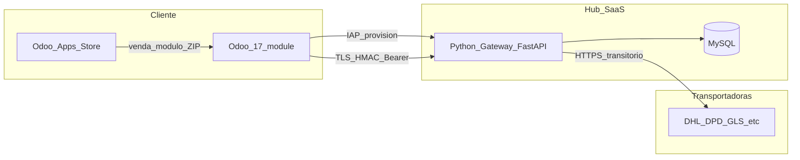
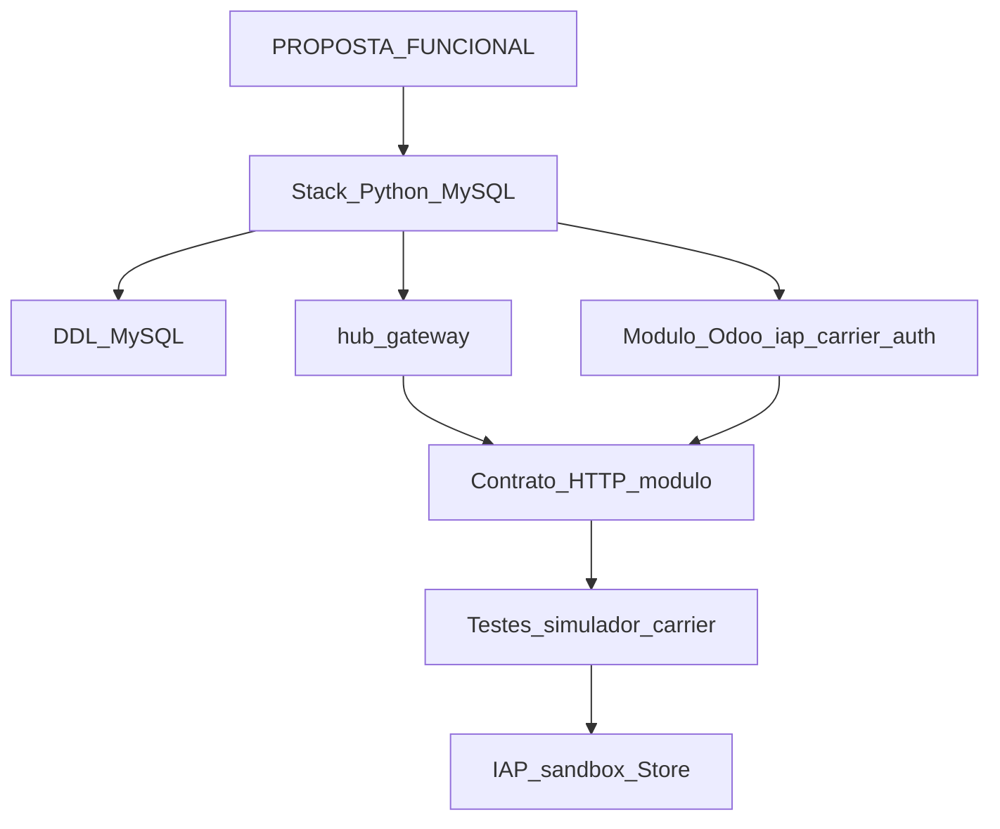

# Stack técnica — OdooCarriers

> Decisões técnicas derivadas de [PROPOSTA_FUNCIONAL.md](./PROPOSTA_FUNCIONAL.md).  
> Integração Odoo.com: [ODOO_APPS_STORE_E_IAP.md](./ODOO_APPS_STORE_E_IAP.md).

Versão: 1.1 · 2026-10-11

---

## Objectivo

Ecossistema **mínimo em runtimes**: um **serviço Python** (gateway + IAP), **MySQL** (contas e quotas), **módulo Odoo 17** no cliente. Sem portal PHP, Node, Supabase ou Stripe na v1 comercial.

---

## Hierarquia documental

| Documento | Papel |
|-----------|--------|
| [PROPOSTA_FUNCIONAL.md](./PROPOSTA_FUNCIONAL.md) | **Documento mestre** — produto, fluxos, ordem §11 |
| **STACK_TECNICA.md** (este ficheiro) | Stack, endpoints, transição auth IAP |
| [ODOO_APPS_STORE_E_IAP.md](./ODOO_APPS_STORE_E_IAP.md) | Apps Store vs IAP (compra, créditos, activação) |
| [AMBIENTE_TESTES_HETZNER.md](./AMBIENTE_TESTES_HETZNER.md) | Deploy gateway, BD validação, túnel MySQL |
| [ARCHITECTURE.md](./ARCHITECTURE.md) | Runtime actual (`hub-gateway`) vs alvo (`carrier_gateway`) |
| [DATABASE_SCHEMA.md](./DATABASE_SCHEMA.md) + `sql/` | DDL MySQL + migrations |

**Fora de âmbito:** projectos legados **hubCarrier** / monorepo Odoo Project antigo — não copiar código nem documentação.


## Transição auth (PROPOSTA §2)

| Fase | Odoo | Gateway |
|------|------|---------|
| **Hoje (ponte)** | `shipping_hub_connector`: Bearer da provision + HMAC; `database.uuid` no header | Valida token hash; regista `accounts.odoo_database_uuid` no 1.º pedido autenticado |
| **Meta** | `odoocarriers_base`: só IAP (sem campo token manual); `gateway_client` único | Auth via IAP JSON-RPC + UUID; Bearer transitório desactivado |

Endpoints MVP alinhados: `GET /api/v1/version`, `POST /api/v1/dpd/connections/test` (simulador), migration [`sql/migrations/002_connections_and_uuid.sql`](sql/migrations/002_connections_and_uuid.sql).

---

## Visão de arquitectura



| Decisão | Descrição |
|---------|-----------|
| Gateway | **Python 3.11+**, **FastAPI**, **httpx** — recebe Odoo, chama APIs carrier |
| Vendas | **Apps Store** (licença do módulo) + **IAP** (créditos / etiquetas) |
| Credenciais DPD | **Só no gateway** (`connections` + `connection_secrets` cifrados); Odoo envia refs, não segredos |
| Autenticação Odoo→Gateway | **IAP** (`iap.account`) + header **`X-Odoo-Database-Uuid`** + HMAC; **Bearer API token** só na ponte (`shipping_hub_connector`) até IAP-only |
| Quotas | MySQL + alinhamento com débito IAP; limites em `docs/config/plan_catalog.json` |

---

## Stack v1

| Camada | Tecnologia | Papel |
|--------|------------|--------|
| ERP cliente | Odoo **17** (Python/XML) | Etiquetas, token API, credenciais carrier, dependência **`iap`** |
| API Hub | FastAPI, uvicorn, httpx, pydantic, driver MySQL | Labels, provision, serviço IAP registado |
| Dados | **MySQL 8** | Tenant, hash do token, plano/consumo, logs operacionais (sem PII destinatário) |
| Planos | `docs/config/plan_catalog.json` | RPM, burst, franquia (sem tabela SQL de planos) |
| Infra | HTTPS (nginx/Caddy), systemd ou Docker Compose | TLS 1.3, segredos em variáveis de ambiente |

### Fora da v1 (redução de tecnologias)

| Excluído | Motivo |
|----------|--------|
| Node.js / PHP portal | Substituído por Python + Store/IAP |
| Supabase / Stripe | Faturação e identidade via Odoo.com |
| Redis | v1: RPM/nonce HMAC em MySQL ou instância única; Redis opcional com scale-out |
| Credenciais carrier em MySQL | Repouso no Odoo |

Odoo no cliente permanece runtime separado (requisito do produto).

### Ambiente actual (testes)

| Runtime | Local |
|---------|--------|
| **Odoo 17** | Máquina de desenvolvimento (Docker) |
| **Hub Gateway** | Servidor Hetzner — `/home/alexander/odoocarriers/hub-gateway` |
| **MySQL** `odoocarriers` | Hetzner, utilizador `@localhost`; dev acede via [túnel SSH](../scripts/mysql-tunnel-dev.sh) |

Detalhe operacional: [AMBIENTE_TESTES_HETZNER.md](./AMBIENTE_TESTES_HETZNER.md). Cada alteração em `hub-gateway/` → `./scripts/deploy-gateway-to-test.sh`.

---

## Repositório (estrutura alvo)

```
OdooCarriers/
  shipping_hub_connector/     # módulo Odoo (existente)
  hub-gateway/                # FastAPI (a implementar)
    .env                      # segredos locais (não versionar)
    .env.example              # template sem valores reais
    app/
      routes/odoo_api.py      # POST /api/v1/shipments/labels, GET /healthz
      routes/accounts.py      # POST /api/v1/accounts/provision
      routes/iap_service.py   # endpoint registado em iap.odoo.com
      middleware/             # HMAC, Bearer
      services/               # quota, token_issue
      adapters/               # DHL, DPD, GLS, …
  scripts/
    deploy-gateway-to-test.sh
    mysql-tunnel-dev.sh
  deploy/server/
    odoocarriers-gateway.service
    hub-test.stip.pt.nginx
  docs/
    PROPOSTA_FUNCIONAL.md
    STACK_TECNICA.md
    AMBIENTE_TESTES_HETZNER.md
    ODOO_APPS_STORE_E_IAP.md
    config/plan_catalog.json
    sql/
      setup_odoocarriers.sql
```

---

## Endpoints do gateway

| Método / rota | Consumidor | Função |
|---------------|------------|--------|
| `GET /healthz` | Operações | Liveness |
| `POST /api/v1/shipments/labels` | Módulo Odoo | Cria etiqueta; valida token + HMAC + quota; adapter carrier |
| `POST /api/v1/accounts/provision` | Módulo Odoo (wizard) | `account_token` IAP → tenant MySQL; devolve **token API uma vez** |
| Serviço **IAP** (URL registada) | iap.odoo.com | authorize/capture por crédito (≈ 1 etiqueta) |

Contrato de labels: path `/api/v1/shipments/labels`, schema `1.0` — alinhado ao cliente HTTP existente no módulo.

**Extensão JSON v1.1 (prevista):** bloco `carrier_auth` no payload (`create_shipment`), preenchido no Odoo; uso **transitório** no gateway.

---

## MySQL (modelo conceptual)

DDL **greenfield** em `docs/sql/` (nome da base na proposta funcional — **não** reutilizar `hubCarrier`).

| Conceito | Conteúdo |
|----------|----------|
| Conta / tenant | Identidade mínima (ex. email, referência IAP) |
| Token API | Apenas **hash** + pepper; token opaco na provision |
| Subscrição / consumo | Plano, estado, contador mensal de etiquetas |
| Mapeamento IAP | `iap_account_token` → tenant interno |
| Shipment logs | Auditoria quota; **sem** moradas nem PDF |

---

## Contratos técnicos (a documentar)

- **SECURITY_STANDARDS.md** — TLS, hash token + pepper, HMAC, fail-closed.
- **JSON canónico** — payload em `shipping_hub_connector/models/stock_picking.py` (`_shipping_hub_build_payload`).
- **DATABASE_SCHEMA.md** — detalhe das tabelas acima.

---

## Módulo Odoo — evolução prevista

1. **`depends`:** incluir `iap`.
2. **Token API:** settings + wizard pós-`POST /api/v1/accounts/provision`.
3. **Credenciais carrier:** campos em `delivery.carrier`; ACL gestor stock.
4. **Payload:** `carrier_auth` no JSON canónico.
5. **Etiquetas:** `iap_charge` / `InsufficientCreditError` → compra de créditos.
6. **Store:** manifest OPL, `price`, listing com packs IAP — ver [ODOO_APPS_STORE_E_IAP.md](./ODOO_APPS_STORE_E_IAP.md).

---

## Configuração e segredos

O Hub SaaS é **Python (FastAPI)** — não há `.env` à escala Laravel/PHP no monorepo. A convenção equivalente para desenvolvimento e deploy é **ficheiro de ambiente no serviço gateway**.

| Componente | Onde guardar | Versionado no Git |
|------------|--------------|-------------------|
| **Hub Gateway** (MySQL, pepper, IAP, URLs) | `hub-gateway/.env` | **Não** |
| Template / documentação de chaves | `hub-gateway/.env.example` | Sim |
| **Produção** (systemd, Docker Compose) | `EnvironmentFile` / `env_file` apontando ao mesmo conjunto de variáveis (ex. `/etc/odoocarriers/gateway.env`) | Não |
| Token API Odoo → Hub | Odoo **Definições** (`ir.config_parameter`) | Por instalação |
| Credenciais transportadora | Odoo `delivery.carrier` | Por instalação |

**Carregamento (implementação `hub-gateway`):** `pydantic-settings` (ou `python-dotenv`) com `env_file=".env"` relativo à raiz de `hub-gateway/` (directório de trabalho do uvicorn).

**Nunca** commitar passwords, peppers ou chaves IAP. Copiar `hub-gateway/.env.example` → `hub-gateway/.env` e preencher localmente.

### Variáveis de ambiente (gateway)

#### Aplicação

| Variável | Uso |
|----------|-----|
| `APP_NAME` | Identificador lógico do serviço (logs, health) — ex. `OdooCarriers` |
| `APP_DEBUG` | `true` em dev (tracebacks, simulador); **`false` em produção** |
| `APP_URL` | URL base interna ou com path (ex. reverse proxy) — ex. `https://stip.pt/odoo` |
| `APP_PUBLIC_URL` | URL pública de referência (links, CORS, registo IAP) — ex. `https://odoo.stip.pt` |

#### MySQL (contas, quotas, logs)

| Variável | Uso |
|----------|-----|
| `DB_HOST` | Host MySQL |
| `DB_PORT` | Porta (predefinição `3306`) |
| `DB_DATABASE` | Nome da base (validação: `odoocarriers` — ver `docs/sql/setup_odoocarriers_saas.sql`) |
| `DB_USERNAME` | Utilizador MySQL |
| `DB_PASSWORD` | Password MySQL |

Na implementação, estes `DB_*` mapeiam a ligação do driver (ex. PyMySQL/asyncmy). Opcionalmente aceitar alias `MYSQL_*` com a mesma semântica.

#### Segurança e integrações

| Variável | Uso |
|----------|-----|
| `SAAS_KEY_PEPPER` | Hash do token API |
| `IAP_SERVICE_KEY` | Chave do serviço registado em iap.odoo.com |
| URLs por carrier | Bases API DHL, DPD, GLS, … |
| `GATEWAY_CARRIER_SIMULATOR` | Testes sem API real (dev; **nunca** em produção) |

Exemplo mínimo local: ver `hub-gateway/.env.example`.

---

## Necessidades operacionais

**Desenvolvimento:** Python 3.11+, MySQL 8 (`docs/sql/setup_odoocarriers_saas.sql` no Hetzner), túnel `./scripts/mysql-tunnel-dev.sh`, Odoo 17 + Docker local (`shipping_hub_connector/install.sh`). Gateway de testes: deploy `./scripts/deploy-gateway-to-test.sh`.

**Testes (Hetzner):** gateway exposto via HTTPS (Nginx → uvicorn); Odoo local com Gateway URL público; MySQL só localhost + túnel na dev.

**Produção comercial:** domínio TLS, MySQL com backups, conta editor Apps Store, monitorização 401/429 e `carrier_error` (sem log de PII).

**Conformidade:** zero persistência de destinatário/etiqueta no MySQL; credenciais carrier só no Odoo.

---

## Roadmap de implementação



1. Validar [PROPOSTA_FUNCIONAL.md](./PROPOSTA_FUNCIONAL.md).
2. Publicar DDL + `DATABASE_SCHEMA.md`.
3. Implementar `hub-gateway` (códigos de erro do módulo).
4. Extender `shipping_hub_connector`.
5. E2E simulador + carrier.
6. IAP sandbox + Apps Store.

---

## Riscos / decisões em aberto

| Tópico | Nota |
|--------|------|
| Registo IAP + packs | `service_name`, créditos por etiqueta, sandbox vs prod |
| RPM/burst sem Redis | Limite single-instance; Redis se scale-out |
| Rotação de token | v1: re-provision / suporte |
| Multi-BD Odoo | Política de quota partilhada vs token por BD |

---

## Histórico

| Data | Alteração |
|------|-----------|
| 2026-03-11 | Documento inicial |
| 2026-10-11 | Secção configuração/segredos; `hub-gateway/.env` e `.env.example` |
| 2026-10-11 | Ambiente testes Hetzner; `odoocarriers_hub`; scripts deploy/túnel |
